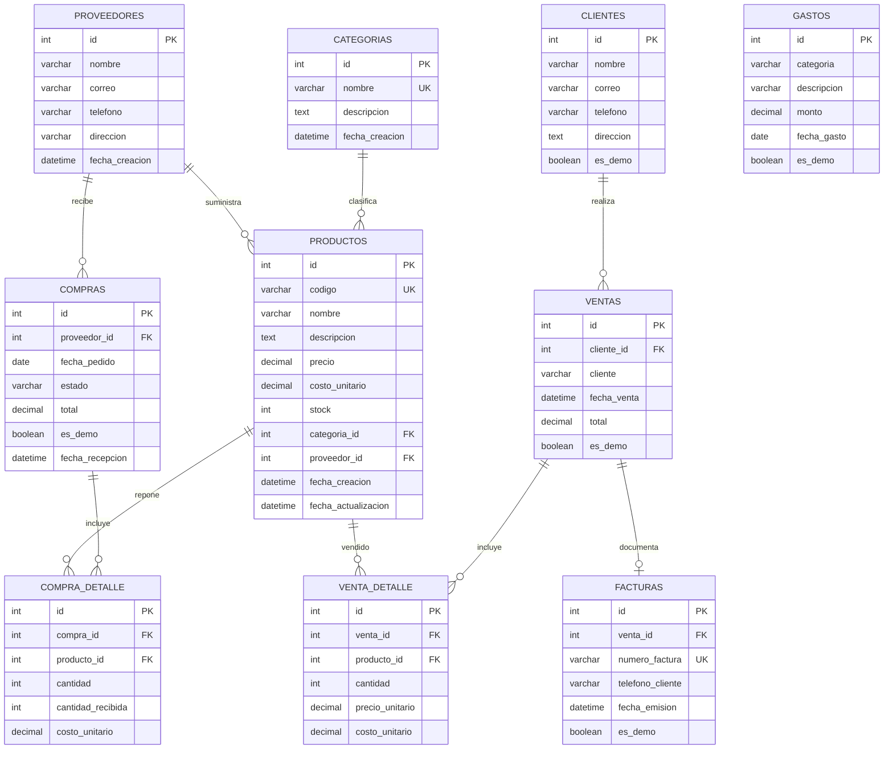

# Modelo de datos

La fuente ejecutable del modelo está en `database/schema.sql`; aplica las migraciones en orden `database/migrations/001_initial_schema.sql`, `002_gastos_rentabilidad.sql`, `003_compras_clientes.sql` y `004_facturas.sql`. La migración de clientes conserva ventas existentes; cada venta pagada nueva crea una factura y guarda el teléfono informado como snapshot. Los seeders `006` y `007` cargan clientes, ventas y pedidos de muestra sin alterar existencias. El diagrama editable está en `docs/diagrama-er.drawio`.
