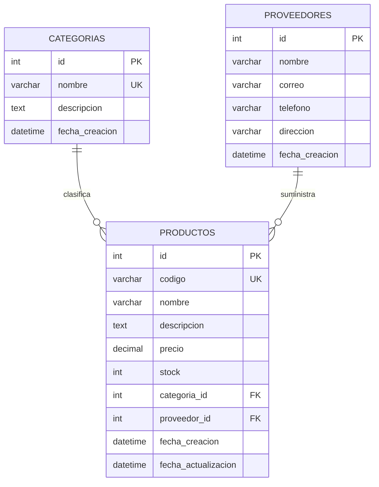

# Modelo de datos

La fuente ejecutable del modelo está en `database/schema.sql` y la migración inicial en `database/migrations/001_initial_schema.sql`. El diagrama editable está en `docs/diagrama-er.drawio`.
